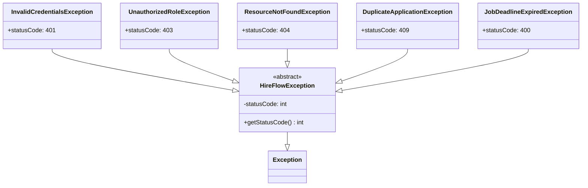

# HireFlow Architecture Specification & Design Blueprint

## 1. Executive Summary
**HireFlow** is an enterprise-grade recruitment and candidate tracking engine written in Core Java 17+. The system delivers high concurrency, low latency, robust Object-Oriented Design (inheritance, polymorphism, encapsulation, abstraction), Java Streams API query engines, persistent serialization, relational JDBC DAO integration, and an ambient glassmorphism Single Page Application (SPA).

---

## 2. UML Class Hierarchy & OOP Domain Model

```mermaid
classDiagram
    direction TB

    class CrudRepository~T, ID~ {
        <<interface>>
        +save(entity: T) T
        +findById(id: ID) Optional~T~
        +findAll() List~T~
        +deleteById(id: ID) boolean
    }

    class SearchFilter~T~ {
        <<functional interface>>
        +filter(items: Collection~T~, predicate: Predicate~T~, sorter: Comparator~T~) List~T~
    }

    class StreamSearchEngine~T~ {
        +filter(items: Collection~T~, predicate: Predicate~T~, sorter: Comparator~T~) List~T~
    }
    SearchFilter <|.. StreamSearchEngine

    class User {
        <<abstract>>
        #id: String
        #name: String
        #email: String
        #password: String
        #role: Role
        #active: boolean
        #createdAt: String
        +getId() String
        +getName() String
        +getEmail() String
        +getRole() Role
        +isActive() boolean
        +setActive(active: boolean) void
        +toJson() String
        +getDashboardMetrics(store: DataStore)* Map~String, Object~
        #appendSubclassJson(sb: StringBuilder)* void
    }

    class Admin {
        +getDashboardMetrics(store: DataStore) Map~String, Object~
        #appendSubclassJson(sb: StringBuilder) void
    }
    User <|-- Admin

    class Recruiter {
        -company: String
        +getCompany() String
        +getDashboardMetrics(store: DataStore) Map~String, Object~
        #appendSubclassJson(sb: StringBuilder) void
    }
    User <|-- Recruiter

    class JobSeeker {
        -profile: SeekerProfile
        +getProfile() SeekerProfile
        +getDashboardMetrics(store: DataStore) Map~String, Object~
        #appendSubclassJson(sb: StringBuilder) void
    }
    User <|-- JobSeeker

    class SeekerProfile {
        -phone: String
        -education: String
        -experience: String
        -skills: List~String~
        -summary: String
        -resume: String
        +getSkills() List~String~
        +setSkills(skills: List~String~) void
    }
    JobSeeker *-- SeekerProfile

    class Job {
        -id: String
        -title: String
        -company: String
        -recruiterId: String
        -location: String
        -type: JobType
        -salary: String
        -deadline: String
        -description: String
        -requirements: RequirementCriteria
        -createdAt: String
        +update(...) void
        +toJson() String
    }

    class RequirementCriteria {
        -minEducation: String
        -minExperience: String
        -requiredSkills: List~String~
        +getRequiredSkills() List~String~
    }
    Job *-- RequirementCriteria

    class JobApplication {
        -id: String
        -jobId: String
        -seekerId: String
        -appliedAt: String
        -status: ApplicationStatus
        +setStatus(status: ApplicationStatus) void
        +toJson() String
    }

    class DataStore {
        +users: Map~String, User~
        +jobs: Map~String, Job~
        +applications: Map~String, JobApplication~
        +loadOrSeed()$ DataStore
        +saveToDisk() void
        +seedDemoData() void
        +toFullStateJson() String
    }
```

---

## 3. Custom Exception Hierarchy

---

## 4. REST API Endpoint Specification

HireFlow's built-in `com.sun.net.httpserver.HttpServer` runs by default on port `8080`.

| Method | Endpoint | Description | Request Body | Response Body | Status Codes |
|---|---|---|---|---|---|
| `GET` | `/api/state` | Retrieves platform state snapshot | None | `{ users, jobs, applications }` | `200 OK` |
| `POST` | `/api/auth/login` | Authenticates user credentials | `{ email, password }` | `{ user, state }` | `200 OK`, `401 Unauthorized`, `403 Forbidden` |
| `POST` | `/api/auth/register` | Registers polymorphic JobSeeker or Recruiter | `{ name, email, password, role, company }` | `{ user, state }` | `201 Created`, `409 Conflict` |
| `POST` | `/api/jobs` | Creates new job posting | `{ title, company, location, type, salary, deadline, minEducation, minExperience, requiredSkills, description }` | Updated `{ users, jobs, applications }` | `200 OK` |
| `PUT` | `/api/jobs` | Updates existing job posting | `{ id, title, company, ... }` | Updated state | `200 OK` |
| `DELETE` | `/api/jobs` | Removes job and cascades deletions to applications | `{ id }` | Updated state | `200 OK` |
| `POST` | `/api/applications` | Submits application with deadline & duplicate check | `{ jobId, seekerId }` | Updated state | `201 Created`, `400 Bad Request`, `404 Not Found`, `409 Conflict` |
| `PUT` | `/api/applications` | Recruiter/Admin updates candidate status | `{ id, status }` | Updated state | `200 OK` |
| `PUT` | `/api/profile` | Updates candidate profile & re-scores matches | `{ id, name, phone, education, experience, skills, summary, resume }` | `{ user, state }` | `200 OK`, `404 Not Found` |
| `PUT` | `/api/users` | Admin toggles user account active/suspended | `{ id }` | Updated state | `200 OK` |
| `DELETE` | `/api/users` | Admin removes user from platform | `{ id }` | Updated state | `200 OK` |
| `GET` | `/*` | Static file handler serving SPA files (`index.html`, `styles.css`, `app.js`) | None | Web asset | `200 OK`, `404 Not Found` |

---

## 5. Persistence Architecture
1. **In-Memory & Object Serialization (`hireflow_store.ser`)**:
   - `DataStore` implements `java.io.Serializable`.
   - On server startup, `DataStore.loadOrSeed()` checks if `hireflow_store.ser` exists.
   - Any mutation (`saveToDisk()`) writes the active graph to disk using `ObjectOutputStream`.
2. **Relational Schema & JDBC DAO (`schema.sql` & `HireFlowJdbcDAO.java`)**:
   - Normalized relational tables: `users`, `seeker_profiles`, `jobs`, `job_applications`.
   - Foreign key integrity with cascading deletes.
   - Transactional safety with explicit commit/rollback controls (`conn.setAutoCommit(false)`).

